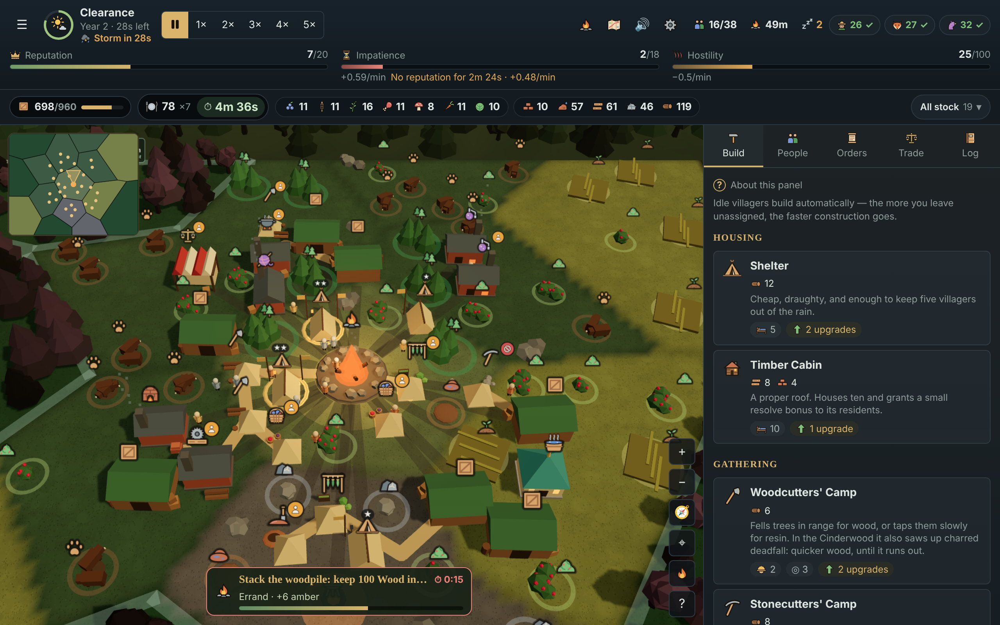

# Emberwatch

A roguelite city builder, built as an offline-capable Progressive Web App with React, TypeScript and three.js.



You are a viceroy sent into a rain-soaked forest. Raise a settlement, keep three species of villager from walking out on you, and earn the Queen's favour before her patience runs out. Every run is a new map, a new draft of buildings and a new set of perks.

## Quick start

```bash
npm install
npm run dev
```

Then open the printed localhost URL.

## How it plays

| | | |
| :-: | --- | --- |
| 👑 | **Goal** | Fill the Queen's **reputation** meter (orders, decrees, glade events, contented villagers) and hold out until her envoy arrives. |
| ⏳ | **Pressure** | You lose if her **impatience** fills first or the settlement collapses. A run takes up to about 40 minutes. |
| 🌧️ | **Seasons** | Drizzle → Clearance → Storm. The Storm stops farms, burns wood at the hearth, chills homes outside its warmth and, from Year 2, brings a forecast blight you can prepare for. |
| 🌲 | **Glades** | Fogged pieces of forest. Clearing them yields land and resources; dangerous ones open events with risky choices, and every cleared glade raises the forest's **hostility**. |
| 🧑‍🌾 | **Villagers** | Each species has a **resolve** score fed by housing, food variety and services such as taverns. If it drops too low they leave. Idle villagers are your builders, so every worker you assign is a builder you gave up. |
| 🏠 | **Building** | Free placement with no grid. Terrain, neighbours and roads change how well a building works, and most buildings can be upgraded. |
| 🃏 | **Drafts** | Blueprints and cornerstone perks are picked from random offers, so each run needs a different plan. Caravans and the Queen's Architect sell what the drafts miss. |
| 🏰 | **Between runs** | Supplies sent home buy Citadel upgrades. There are also commissions (optional run objectives), a seven-rung difficulty ladder, a daily expedition shared by all players, and 32 achievements. |

🗺️ The map has a 3D view and a 2D view, 📱 the layout adapts to phones, and ⌨️ the whole game can be played from the keyboard. 💡 In-game coach tips explain each system the first time it matters.

## Commands

| Command | What it does |
| --- | --- |
| `npm run dev` | Dev server |
| `npm run build` | Typecheck, production build and service worker |
| `npm run preview` | Serve the built PWA (installable, works offline) |
| `npm test` | Simulation and UI tests (Vitest) |
| `npm run test:balance` | Balance harness: a bot plays whole runs (takes a few minutes) |
| `npm run test:e2e` | Real-browser smoke test (Playwright; run `npx playwright install chromium` once) |
| `npm run lint` | ESLint, including the engine purity rules |
| `npm run check` | Typecheck, lint and `npm test` (what the pre-commit hook runs) |
| `npm run build:artifact` | Build the page for the claude.ai Artifact into `dist-artifact/` |

## Architecture

```
src/
  art/          icon set as SVG path data (no image files)
  game/
    types.ts    the domain model; RunState is plain and serialisable
    content/    data-only definitions: buildings, species, events, orders...
    engine/     pure rules, with no React and no DOM
    engine/bot/ the heuristic bot behind the balance harness
    store.ts    zustand store: run, meta progression, settings, commands
  ui/           React components; they read the sim and contain no rules
    map3d/      three.js scene via react-three-fiber
e2e/            Playwright smoke test
scripts/        icon generation, artifact page, git hook install
```

- **Deterministic.** All run randomness is `f(seed, cursor)` with the cursor stored in `RunState`, so a seed replays the same map and a save resumes to the same future.
- **No server.** Runs autosave to `localStorage` in four slots and can be exported and imported as JSON. A Workbox service worker precaches the app, so it works offline after one load.
- **Pure engine.** ESLint stops `src/game/engine` and `src/game/content` from importing React, the store or the UI, or touching browser globals.
- **No binary assets.** Icons are SVG paths, app icons are generated at build time, and audio is synthesised with WebAudio.

## CI

`.github/workflows/ci.yml` runs typecheck, lint, `npm test` and the build. It is currently triggered by manual dispatch only. The balance harness and the Playwright smoke test are left out to keep the pipeline short; run them locally with `npm run test:balance` and `npm run test:e2e`. `npm install` also sets up a pre-commit hook that runs `npm run check`; skip it once with `git commit --no-verify`.

## Known limits

- No world-map campaign: meta progression is the upgrade tree, the difficulty ladder and commissions.
- About 30 buildings, 45 glade events and 40 cornerstones, a small catalogue for the genre.
- Roads are straight stretches with no traffic; villagers walk them for show while the simulation stays assignment-based.
- Updating dependencies needs npm 11 (`npx npm@11 update <pkg>`); npm 10 crashes when re-resolving this tree, though `npm ci` works.
